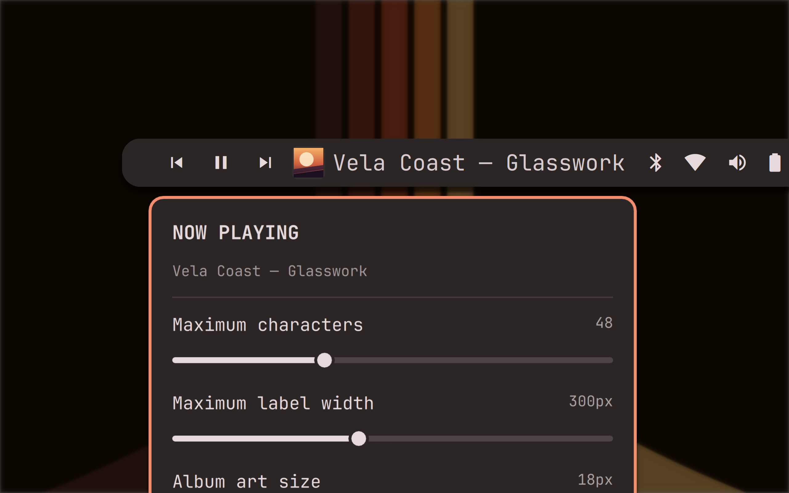

# Media Controls + Album Art for Omarchy

A native Quattro/Quickshell now-playing widget for the Omarchy bar, with media
controls, live album art, and artist/title details:



`previous` · `play/pause` · `next` · `album art` · `artist — title`

Optional seek buttons go back and forward 10 seconds:
`previous` · `back 10 s` · `play/pause` · `forward 10 s` · `next`. Turn them on
with "Show seek buttons" in the appearance panel. They are disabled when the
player does not support seeking.

On crowded horizontal bars, the widget adapts independently on each monitor.
It shortens the label first, then drops previous/next and the seek buttons,
play/pause, and artwork as necessary so it gives space back before the bar
sections overlap. The full track details remain available in the tooltip.

Adaptive sizing measures the visible slots in each bar window, including on
hosts that expose the restricted plugin bar API. It applies in the left and
right sections; centered placement still needs layout cooperation from the
host. If even the compact control cannot fit, the widget temporarily hides
until space is available again.

It works with Spotify and other Linux media players that expose the standard
MPRIS interface. The widget uses Quickshell's MPRIS service directly: it does
not poll `playerctl` or depend on the old Waybar scripts. It also works on custom or cloned bars, which do not receive
the shell's plugin services: there the widget runs its own copy of the
service.

## Install

```bash
omarchy plugin add https://github.com/crmne/omarchy-mpris.git --enable --yes
omarchy bar move crmne.mpris --section right --before omarchy.tray
```

## Requirements

- Omarchy Quattro with its Quickshell-based shell.
- At least one media player exposing the standard MPRIS interface.
- `/usr/bin/python3` for the album-art helper. No extra packages.

This plugin uses Quickshell's MPRIS service directly and does not require
`playerctl`.

## Album art

The shell never downloads album art itself. Given an `http(s)` URL, Qt's
`Image` holds the whole response in memory before decoding it, so a cover
server answering with something huge could exhaust the memory of the shell
and every widget in it. Instead, the plugin runs `/usr/bin/python3` with
`bin/artwork`, which downloads the cover the player advertises with a hard
limit of 16 MiB and 20 seconds, refusing it as soon as either is passed, and
the widget loads the result from a private cache under
`~/.cache/omarchy/mpris/artwork`. The cache keeps the 64 most recent covers,
up to 64 MiB in all.

Covers the player keeps on disk (`file://`) are not copied: they are shown
only if they are regular files within the same 16 MiB limit. The helper
follows `http` and `https` only, re-checking every redirect, and ignores other
URL schemes. The cover URL travels in the helper's environment, which only you
can read, rather than on its command line, which every user on the machine can
see.

## Remove

```bash
omarchy plugin remove crmne.mpris --yes
```

For local development, put or link this repository at
`~/.config/omarchy/plugins/crmne.mpris` and run:

```bash
omarchy-shell shell rescanPlugins
omarchy plugin enable crmne.mpris --section right --before omarchy.tray
```

Click album art or the label to raise the player, and middle-click there for
the previous track. Scrolling anywhere over the controls changes track.
Right-click any part of the widget to open its appearance panel.

The appearance panel and Omarchy bar settings expose adaptive layout,
transport controls, seek buttons, album artwork, artist visibility, album-art
size, label width, and a maximum artist/title character count.

## Screenshots

`preview.png` shows the actual widget and its appearance panel with synthetic
data: an invented artist and tracks and a self-drawn abstract cover. It shows
the full layout while playing, with the panel opened under it, large and in the
middle of the image, because the marketplace card shows only a wide strip from
the middle and websites crop it to 16:9.

`tools/capture/` copies the production `BarWidget.qml`, `BarGeometry.js`,
`ServiceSource.qml`, `TextLimit.js` and `Transport.js` into a temporary
offscreen Quickshell host with Omarchy's installed `Commons` and `Ui`, the
Ristretto theme, and JetBrainsMono Nerd Font. `Service.qml` is replaced by a
fixture with no MPRIS import, so the capture never sees or controls a real
media player. The workspaces, clock and tray icons beside the widget are plain
stand-ins drawn with the bar's font and colors. The background is Omarchy's
Ristretto wallpaper, blurred and darkened.

```bash
gpu-lock /usr/bin/python3 -B tools/capture/capture.py [captures-dir]
```

`gpu-lock` is the maintainer's machine-wide GPU mutex. The script requests
OpenGL and refuses a software-rendered capture.

## Validation

Run the geometry, service-lookup, label-truncation, seek, and artwork
regression tests with Qt Quick Test, and the artwork helper's tests with
Python:

```bash
QT_QPA_PLATFORM=offscreen /usr/lib/qt6/bin/qmltestrunner -input tests
python3 -m unittest discover -s tests
```
