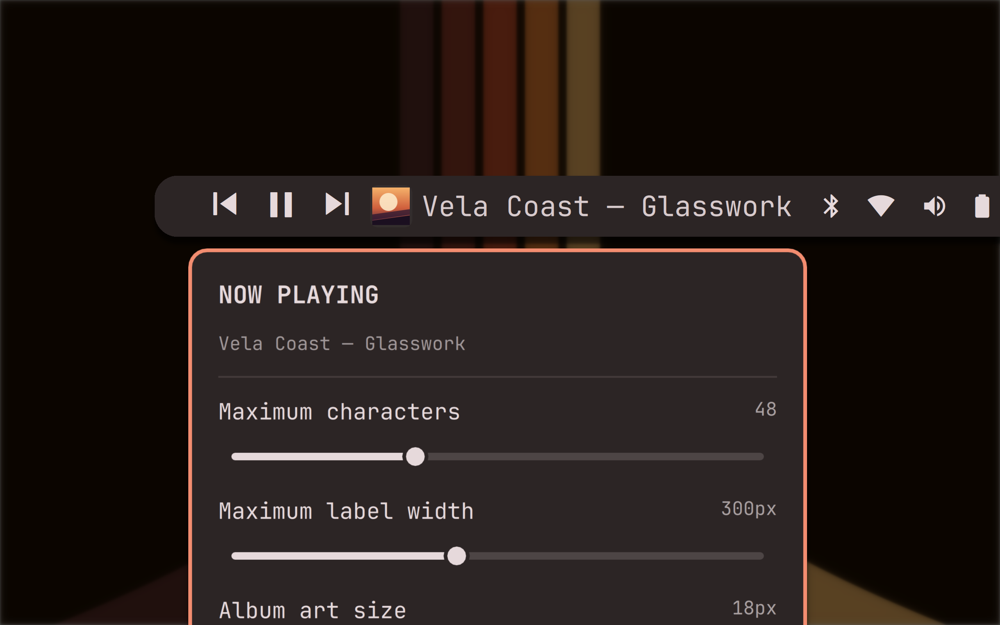

# Media Controls + Album Art for Omarchy

A native Quattro/Quickshell now-playing widget for the Omarchy bar, with media
controls, live album art, and artist/title details:



`previous` · `play/pause` · `next` · `album art` · `artist — title`

Optional seek buttons go back and forward 10 seconds:
`previous` · `back 10 s` · `play/pause` · `forward 10 s` · `next`. Turn them on
with "Show seek buttons" in the appearance panel. They are disabled when the
player does not support seeking.

On crowded horizontal bars, the widget adapts independently on each monitor.
It shortens the label first, then drops previous/next and the seek buttons,
play/pause, and artwork as necessary so it gives space back before the bar
sections overlap. The full track details remain available in the tooltip.

Adaptive sizing measures the visible slots in each bar window, including on
hosts that expose the restricted plugin bar API. It works in every section of
Omarchy 4.5's bar: in the left and right sections, in `centerEnd` up to the
right section and in `centerBegin` up to the left one, and in the centered
`center` box, which grows both ways, with twice the room on its tighter side.
Where a display notch moves the center sections beside the right one, all of
them share the room up to the left section. In the tray's drawer, and on bars
it cannot measure, the widget keeps its full layout. If even the compact
control cannot fit, the widget temporarily hides until space is available
again.

It works with Spotify and other Linux media players that expose the standard
MPRIS interface. The widget uses Quickshell's MPRIS service directly: it does
not poll `playerctl` or depend on the old Waybar scripts. It also works on custom or cloned bars, which do not receive
the shell's plugin services: there the widget runs its own copy of the
service.

## Install

```bash
omarchy plugin add https://github.com/crmne/omarchy-mpris.git --enable --yes
omarchy bar move crmne.mpris --section right --before omarchy.tray
```

## Requirements

- Omarchy Quattro with its Quickshell-based shell.
- At least one media player exposing the standard MPRIS interface.
- `/usr/bin/python3` for the album-art helper. No extra packages.

This plugin uses Quickshell's MPRIS service directly and does not require
`playerctl`.

## Album art

The cover is fetched only while a bar widget shows it. With **Show album art**
off, or on a vertical bar, where the widget draws no artwork, the player's
cover URL is never requested.

The shell never downloads album art itself. Given an `http(s)` URL, Qt's
`Image` holds the whole response in memory before decoding it, so a cover
server answering with something huge could exhaust the memory of the shell
and every widget in it. Instead, the plugin runs `/usr/bin/python3` with
`bin/artwork`, which downloads the cover the player advertises with a hard
limit of 16 MiB and 20 seconds, refusing it as soon as either is passed, and
the widget loads the result from a private cache under
`~/.cache/omarchy/mpris/artwork`. The cache keeps the 64 most recent covers,
up to 64 MiB in all.

A small file can still cost a lot to decode: a PNG of a few kilobytes can
declare billions of pixels, or carry compressed text and colour profiles that
inflate to gigabytes. So the helper hands Qt only a PNG or JPEG no larger than
3072 pixels a side, rewritten with just what draws the picture: text, colour
profiles, EXIF, comments and other metadata are dropped, and a PNG whose pixel
data inflates to more than its size needs is refused. Covers the player keeps
on disk (`file://`) go through the same check into the same cache once they
are regular files within 16 MiB, so Qt only ever opens the helper's own copy,
never the player's path. Anything else, including GIF, WebP and larger
pictures, shows no cover.

The helper follows `http` and `https` only, re-checking every redirect and
never reading a redirect's body, and ignores other URL schemes. The cover URL
travels in the helper's environment, which only you can read, rather than on
its command line, which every user on the machine can see.

The player chooses where its cover lives, so the helper connects only to
public internet addresses. A cover on this machine or on a local or private
network (loopback, private and link-local ranges, carrier-grade NAT and the
like) is refused before any connection is made, on every redirect hop, and the
address checked is the one connected to. Proxy settings are not used for
covers, since a proxy would make that connection instead.

## Remove

```bash
omarchy plugin remove crmne.mpris --yes
```

For local development, put or link this repository at
`~/.config/omarchy/plugins/crmne.mpris` and run:

```bash
omarchy-shell shell rescanPlugins
omarchy plugin enable crmne.mpris --section right --before omarchy.tray
```

Click album art or the label to raise the player, and middle-click there for
the previous track. Scrolling anywhere over the controls changes track.
Right-click any part of the widget to open its appearance panel.

The appearance panel and Omarchy bar settings expose adaptive layout,
transport controls, seek buttons, album artwork, artist visibility, album-art
size, label width, and a maximum artist/title character count.

## IPC

The widget registers the `crmne.mpris` IPC target:

```bash
omarchy-shell crmne.mpris playPause
omarchy-shell crmne.mpris seekBy -10
```

`playPause`, `previous`, `next`, `raise`, and `seekBy <seconds>` return `ok`
when the active player handled the command and `unhandled` otherwise.
`seekBy` takes a nonzero number of seconds, negative to go back, and needs a
player that supports seeking. `status` returns JSON with `available`,
`playing`, `player`, `artist`, `title`, `album`, `artUrl`, `canGoPrevious`,
`canGoNext`, and `canSeek`.

## Screenshots

`preview.png` shows the actual widget and its appearance panel with synthetic
data: an invented artist and tracks and a self-drawn abstract cover. It shows
the full layout while playing, with the panel opened under it, large and in the
middle of the image, because the marketplace card shows only a wide strip from
the middle and websites crop it to 16:9.

`tools/capture/` copies the production `BarWidget.qml`, `BarGeometry.js`,
`ServiceSource.qml`, `TextLimit.js` and `Transport.js` into a temporary
offscreen Quickshell host with Omarchy's installed `Commons` and `Ui`, the
Ristretto theme, and JetBrainsMono Nerd Font. `Service.qml` is replaced by a
fixture with no MPRIS import, so the capture never sees or controls a real
media player. The workspaces, clock and tray icons beside the widget are plain
stand-ins drawn with the bar's font and colors. The background is Omarchy's
Ristretto wallpaper, blurred and darkened.

```bash
/usr/bin/python3 -B tools/capture/capture.py [captures-dir]
```

The script requests OpenGL and refuses a software-rendered capture.

## Validation

Run the geometry, service-lookup, label-truncation, seek, and artwork
regression tests with Qt Quick Test, and the artwork helper's and QML color
checks with Python:

```bash
QT_QPA_PLATFORM=offscreen /usr/lib/qt6/bin/qmltestrunner -input tests
python3 -m unittest discover -s tests
```
